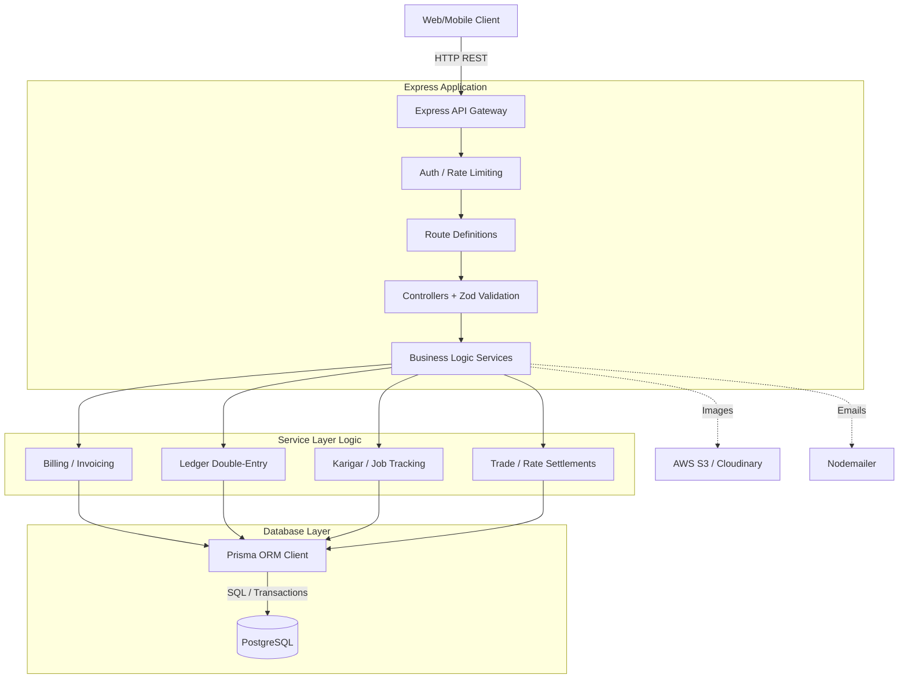

# Gold Billing ERP - Complete Project Understanding Map

This document serves as a deep-dive architectural map of the **Gold Billing/Jewelry Management ERP**. It is designed to onboard 10x engineers and AI agents instantly by explaining the system's structural DNA, data flows, and hidden complexities.

---

## 1. 🧠 High-Level Architecture

*   **System Type:** Monolithic REST API Backend.
*   **Architectural Pattern:** Layered Architecture (Controller-Service-Data Access).
*   **Technology Stack & Rationale:**
    *   **Node.js & Express.js (v5):** Chosen for rapid API development and massive ecosystem.
    *   **TypeScript:** Ensures type safety across the complex financial and weight calculation logic.
    *   **Prisma ORM:** Provides a type-safe database client, crucial for maintaining relational integrity across deep chains (e.g., `Shop -> Billing -> Items -> Ledger`).
    *   **PostgreSQL:** Relational database ideal for ACID-compliant financial and inventory transactions.
    *   **Zod:** Used at the controller layer for strict runtime request validation.

---

## 2. 🧩 Module & Responsibility Map

The system is logically partitioned into functional domains (primarily under `src/services/shop` and `src/controllers/shop`):

| Module | Core Responsibility | Key Business Logic |
| :--- | :--- | :--- |
| **Authentication & Users** | RBAC (Role-Based Access Control) | Manages SuperAdmin, Admin, Shop, Worker, and Salesman roles. |
| **Billing Engine** | Transaction management | Handles `SELL` and `BUY` operations, calculates gross/net weights, making charges, GST, discounts, and exchange values. Generates associated Ledger entries automatically. |
| **Ledger & Accounting** | Financial truth and history | A double-entry accounting system tracking Debits/Credits for Cash, Gold, and Silver across different categories (Income/Expenditure). |
| **Job / Manufacturing** | Tracking the jewelry making lifecycle | Manages raw gold issued to **Karigars** (workers), tracks multi-stage processes, calculates labor charges (fixed/percentage), and accounts for material wastage. |
| **Trade & Rates** | Commodity trading and live pricing | Tracks global Gold/Silver rates. Manages forward/spot trades with clients and suppliers, calculating rate differences and settlement amounts. |
| **Inventory & Ornaments** | Stock tracking | Differentiates between raw metal (`Inventory`) and finished goods (`Ornament`). Handles complex relationships like `Crystals` (stones) embedded in ornaments. |

---

## 3. 🔁 Data Flow (CRITICAL)

The application strictly follows a unidirectional layered data flow.

### Standard Request Lifecycle:
`Client Request` ➔ `Express Middlewares (Auth, Rate Limit)` ➔ `Routes` ➔ `Controller` ➔ `Service` ➔ `Prisma ORM` ➔ `PostgreSQL`

### Core Business Flow Example: **Billing Creation Flow**
1.  **Request:** User submits a bill payload (items, exchange items, cash paid).
2.  **Controller (`billing.controller.ts`):** Validates the payload using **Zod** (`createBillingSchema`). Extracts `adminId` and `shopId` from the authenticated JWT.
3.  **Service (`billing.service.ts`):**
    *   Calculates due amounts and updates the `Client`'s balance.
    *   Creates the `billing` record and nested `billingItem` / `exchangeItem` records.
    *   **CRITICAL:** Enters a Prisma `$transaction` to ensure ACID compliance.
    *   Updates the `Rates` table if the bill dictates a new local rate.
    *   Creates multiple `ledger` entries (Debit/Credit) for the cash paid, gold given, and silver received.
4.  **Database:** Commits the transaction.
5.  **Response:** Returns the newly created bill with HTTP 201.

---

## 4. 🗃️ Data Model Understanding

The database schema (`prisma/schema.prisma`) is highly relational and designed for multi-tenancy (`Admin` owns `Shops`, `Shops` own everything else).

*   **`Admin` & `Shop`:** The root tenants. Every major entity links back to `shopId` and `adminId`.
*   **`billing` & `ornamentBilling`:** Complex models storing financial aggregates (subTotal, totalTax, netPayable, balanceDue). They act as the root for `billingItem` (new items being sold) and `exchangeItem` (old items given by the customer).
*   **`ledger`:** The most important table for financial health. Tracks `cash`, `gold`, and `silver` amounts as `DEBIT` or `CREDIT`. Belongs to an `Account` and a `LedgerCategory`.
*   **`Job` & `JobStage`:** Models the manufacturing workflow. A `Job` represents the order. A `JobStage` represents the metal sitting with a specific `karigar` undergoing a `process`.
*   **`Trade`:** Models a financial contract (Buy/Sell) locked at a specific `rate` and `weight`, which may be settled later.

---

## 5. ⚙️ Core Business Logic

### A. The Ledger "Double-Entry" System
Whenever a transaction occurs (Bill, Trade, Settlement), the system automatically writes to the `ledger`. For example, in a `SELL` bill:
*   **Credit:** Cash paid by the customer is credited to the Shop's Income Ledger.
*   **Debit:** The weight of the Gold/Silver sold is debited from the Shop's material ledger.
*   **Credit:** If the customer exchanged old gold, the fine weight of that old gold is credited back to the material ledger.

### B. Manufacturing Wastage & Labor (Karigar Flow)
When raw metal is issued to a Karigar (Worker), a `JobStage` is created (`fineGoldIssued`). Upon return, the system records `goldReceived` and calculates `wastage`. It also calculates `labourCharges` based on either a `FIXED` rate or a `PERCENTAGE` of the weight/value.

### C. Daily Balance Cron Job
A cron job is scheduled to run daily at 23:59 to calculate the current total balances for each shop. It iterates through all ledger transactions, summing the `cash`, `gold`, and `silver` based on `CREDIT` and `DEBIT` entries. The final calculated balances are then saved to the `ShopCloseBalance` model for the current day and to the `ShopOpenBalance` model for the upcoming day.

### D. Dashboard API & Detailed Day Book
The dashboard provides a real-time "Detailed Day Book" view, which is critical for daily reconciliation and financial transparency.
*   **Opening Balance:** Retrieved from the `ShopOpenBalance` model for the selected date. This represents the cumulative state of cash, gold, and silver at the start of the business day.
*   **Today's Activity:** A dynamic calculation performed by the `DashboardService`. It aggregates all `ledger` entries for the current day, calculating the net movement of `Net Cash`, `Net Gold`, and `Net Silver`.
*   **Closing Balance:** Calculated as `Opening Balance + Today's Activity`. This value represents the current live position and is eventually persisted by the **Daily Balance Cron Job** into the `ShopCloseBalance` model.
*   **Transaction Ledger:** A chronological list of all financial movements (Sales, Purchases, Karigar Issues) fetched from the `ledger` table, ensuring every transaction is accounted for and providing a running balance for each entry.

### E. Business Analysis Reports
The dashboard provides several specialized reporting APIs to facilitate business intelligence and reconciliation:
*   **Sales Analysis Report:** Merges `billing` (SELL type) and `ornamentBilling` data. Calculates total value and net weight for a given period.
*   **Purchase Analysis Report:** Similar to Sales Analysis but focuses on `billing` records with the `BUY` transaction type, helping track inventory inflows.
*   **Stock Analysis Report:** Provides a real-time snapshot of the `Inventory` table merged with `ledger` movements, aggregating total weight, estimated value, and providing a chronological history of stock entries.
*   **Client Ledger Report:** Generates a detailed transactional statement for a specific client. It tracks all `CREDIT` and `DEBIT` movements across Cash, Gold, and Silver, calculating a running balance for every entry.
*   **Profit & Loss Statement:** Financial overview aggregating Revenue Streams (Sales, Making Charges, etc.) and Operating Expenses (Purchases, Labour, Rent, etc.). It calculates Net Profit and identifies performance trends.
*   **GST & Tax Compliance Report:** Unified ledger of Output GST (from Sales) and Input ITC (from Purchases). Provides breakdown of CGST/SGST/Total GST per invoice and calculates Net GST Payable.
*   **Karigar (Artisan) Report:** Tracks fine gold issues, receipts, and wastage per Karigar. Provides a net metal balance and pending job counts for artisan reconciliation.
*   **Pending Dues Report:** Real-time list of all clients with outstanding balances, sorted by the due amount to facilitate debt collection.
*   **Booking Ledger (Trade) Report:** Oversees pending metal deliveries and locked rates. Calculates real-time **Unrealized PNL** by comparing locked rates with live market rates.
*   **Filtering:** All reports support granular filtering by Date Range, Metal Type (Gold/Silver), and keyword search.

---

## 6. 🔌 Integrations & External Systems

*   **S3 / Cloudinary:** Used for storing images of Ornaments (`ornamentImages`), Admins, and Job references (`JobImage`). (Referenced in `package.json` dependencies).
*   **Nodemailer:** Used for sending verification emails and OTPs during user registration/password resets.
*   **JWT (JSON Web Tokens):** Stateless authentication mechanism.

---

## 7. 🧪 Execution Lifecycle

1.  **Bootstrapping (`src/index.ts`):** Prisma connects to the PostgreSQL database.
2.  **Server Initialization (`src/app.ts`):** Express app is instantiated.
3.  **Security & Parsers:** Helmet, CORS, and Express Body Parsers (with 16mb limits for image uploads) are attached.
4.  **Logging & Limiting:** Morgan setup for request logging; Rate Limiting applied to `/v1/auth` in production.
5.  **Routing:** API routes (`/api/v1`) are mounted.
6.  **Error Handling (Bottom of Stack):** Custom `errorConverter` and `errorHandler` catch unhandled exceptions, transform them into standard `ApiError` shapes, and return uniform JSON responses.

---

## 8. 🧭 Developer Mental Model (VERY IMPORTANT)

How to think about and work in this codebase:

1.  **Multi-Tenancy is King:** You must *always* scope queries by `adminId` and `shopId`. Never write a `.findMany()` without filtering by the shop, or you will leak data between clients.
2.  **Fat Services, Skinny Controllers:** All business logic belongs in `src/services/`. Controllers should ONLY handle Zod validation, extracting IDs from `req.user`, calling the service, and sending the HTTP response.
3.  **Follow the Money (Ledger):** If you create a new feature that moves money or metal (e.g., a "Refund" feature), you **must** write the corresponding `ledger` entries using Prisma `$transaction`. Without ledger entries, the shop's dashboard and balance sheets will be permanently corrupted.
4.  **Type Safety:** Rely heavily on Zod inferred types (`z.infer<typeof schema>`) for service parameters to maintain end-to-end type safety.

---

## 9. ⚠️ Risks & Complexity

*   **Floating Point Precision:** The schema uses Prisma's `Float` type for weights and currency (e.g., `gold: Float`, `subTotal: Float`). JavaScript's IEEE 754 floating-point math can lead to precision loss (e.g., `0.1 + 0.2 = 0.30000000000000004`). *Risk:* Rounding errors in financial ledgers over thousands of transactions.
*   **Orphaned Records:** Deep relations (e.g., `Ornament -> OrnamentCrystal`) need careful cascade deletions. While `onDelete: Cascade` is used in some places, ensure it is universally applied to avoid database bloat.
*   **Transaction Deadlocks:** Deep ledger transactions locking multiple rows could cause deadlocks if traffic scales heavily.

---

## 10. 📊 Visual Diagram

